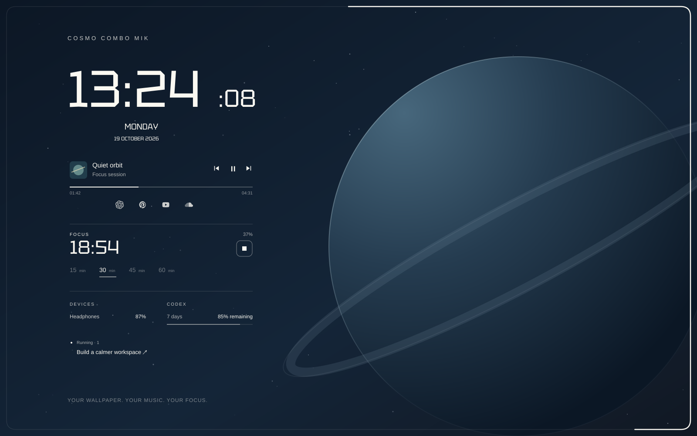

# Cosmo Combo MIK

**A futuristic macOS desktop that helps you focus, without hiding your wallpaper.**

Cosmo Combo brings a seconds-accurate clock, music controls, a visual Pomodoro timer and useful status information into one quiet, coherent layout. White Tektur typography, fine lines and icon-only shortcuts keep the desktop open and readable. Use it over your own static or live wallpaper.



*Illustrated preview with example data. The project does not include or replace your wallpaper.*

## What makes it useful

- **Time comes first.** Large hours and minutes, smaller live seconds, then the weekday and date.
- **Music stays close.** Current artwork, title and artist, previous/play/next controls, and a seekable progress line. Uses macOS Now Playing through `media-control`; support depends on the active player.
- **Focus has a visible shape.** Pick **15, 30, 45 or 60 minutes**. A thin white line gradually traces the desktop perimeter. It stays at desktop level, underneath normal windows, rather than drawing over your apps.
- **Breaks are deliberate.** At the end of a session, “Time for a break” appears. Start a five-minute break when you are ready, or stop at any time. No automatic endless work/break loop.
- **One session across displays.** The timer shares an absolute deadline across screens and survives widget refreshes. Sleep counts toward the deadline.
- **Battery information, when available.** Connected Bluetooth devices report the battery values exposed by macOS. Missing battery data is shown as a dash.
- **Optional Codex awareness.** See remaining quota and up to two running local tasks. Click a task to open its chat in Codex.
- **Just the shortcuts you need.** ChatGPT, Pinterest, YouTube and SoundCloud, with labels on hover.

The layout adapts to regular and ultrawide displays. There are no heavy text shadows or large opaque panels. A dark, quiet area of your wallpaper gives the white interface its best contrast.

## Install

You need:

- macOS and [Übersicht](https://tracesof.net/uebersicht/), installed and running.
- Apple Command Line Tools (`xcode-select --install`) to compile the small native perimeter helper locally.
- [media-control](https://github.com/ungive/media-control) for music metadata and playback actions. With Homebrew: `brew install media-control`.

Clone and install:

```bash
git clone https://github.com/Mikarmk/Cosmo-Combo-MIK.git
cd Cosmo-Combo-MIK
./scripts/install.sh
```

In Übersicht, choose **Refresh All Widgets**. If you use multiple monitors, enable **Show on All Screens** for the widget in Übersicht.

The installer builds the native helper for your Mac and copies the widget to:

```text
~/Library/Application Support/Übersicht/widgets/cosmo-combo
```

It preserves an existing `config.json` and timer state. It does not install dependencies, change your wallpaper, add a login item or grant macOS permissions.

If your Übersicht widgets folder is customized, copy the installed folder there and update `ROOT` in `widget.jsx` to match. `COSMO_INSTALL_DIR` is available for staging or a custom destination; the same `ROOT` adjustment applies.

### Download from the Übersicht gallery

Download [Cosmo-Combo-MIK.widget.zip](https://github.com/Mikarmk/Cosmo-Combo-MIK/raw/main/Cosmo-Combo-MIK.widget.zip), extract it, and move the `Cosmo-Combo-MIK.widget` folder into your Übersicht widgets folder.

For the native perimeter, build the included source once:

```bash
bash "$HOME/Library/Application Support/Übersicht/widgets/Cosmo-Combo-MIK.widget/setup.command"
```

This requires Apple Command Line Tools, as described above. Then refresh the widget. The ZIP contains source and assets, not a prebuilt executable. Codex integration remains opt-in.

The gallery image is [screenshot.png](screenshot.png), a 516 × 320 PNG rendering of the illustrated example shown above.

## Use the timer

1. Select **15 / 30 / 45 / 60 min** and press **Start**.
2. The desktop perimeter fills clockwise as the session elapses.
3. Press the square stop button at any time. When the desktop is covered, the timer's menu-bar item also offers **Stop timer**.
4. At completion, press **Break · 5 min** to begin a break.
5. After the break, press **New focus** to return to duration selection.

The native helper ignores mouse input over the desktop, respects Reduce Motion, and exits shortly after you stop. It is launched only when a timer starts. The contour is intentionally a desktop feature; full-screen applications should not receive an always-on-top border.

## Optional Codex integration

This integration is **off by default**. To enable it, install/sign in to the Codex CLI and change the installed widget's `config.json`:

```json
{
  "codex_enabled": true
}
```

No API key is pasted into the widget. The collector calls the locally installed Codex app-server's read-only `account/rateLimits/read` method, using the CLI's existing sign-in. It never starts an agent turn or consumes a rate-limit reset. See the [official app-server documentation](https://learn.chatgpt.com/docs/app-server#auth-endpoints).

Quota refreshes every five minutes and is marked stale after fifteen minutes without a successful update. Percentages mean **remaining**, not consumed.

Task status refreshes every five seconds using read-only local Codex metadata and lifecycle events. Only local tasks are covered; cloud tasks are not. This part relies on internal SQLite/rollout formats and may need updates as Codex changes. Existing thread titles are displayed in their original language.

## Data and limitations

- No telemetry or analytics are added by this project.
- Runtime caches contain only the display data needed by the widget. They are local, excluded from Git, and must not be included when sharing your installed folder.
- Album artwork comes from the active player's Now Playing metadata. It is not bundled with the project.
- Bluetooth refreshes about once a minute. Some devices do not expose battery levels to macOS.
- Player controls work only when the active player supports the corresponding macOS action.
- Task links require the Codex desktop app and its `codex://` URL handler.
- The native border has been tested on the author's Apple Silicon Mac with a regular display and an ultrawide display. Other macOS versions and hardware still need community testing.

## Customize and develop

- `widgets/cosmo-combo/widget.jsx` — layout, colors, shortcuts and UI.
- `widgets/cosmo-combo/config.json` — optional integrations.
- `widgets/cosmo-combo/lib/focus.py` — shared timer state.
- `widgets/cosmo-combo/lib/dashboard.py` — one-second clock and cached data composition.
- `widgets/cosmo-combo/lib/collector.py` — Bluetooth and optional Codex collectors.
- `native/FocusPerimeter.swift` — desktop-level perimeter and menu-bar controls.

```bash
./scripts/test.sh
```

To rebuild the gallery archive after changing the widget:

```bash
python3 scripts/package.py
```

The timer uses absolute timestamps instead of decrementing a counter. Both displays read the same state, so refreshing one widget does not restart the session.

## Credits and license

Created by [Mikarmk](https://github.com/Mikarmk). Built for [Übersicht](https://github.com/felixhageloh/uebersicht), using [Tektur](https://github.com/hyvyys/Tektur) and [media-control](https://github.com/ungive/media-control).

Own source: [MIT](LICENSE). Font and icon notices: [THIRD_PARTY.md](THIRD_PARTY.md).
